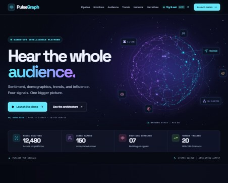

# PulseGraph — AI Social Media Audience Intelligence Platform

PulseGraph is a single-page, interactive replay of the fictional Nova X1 launch. The replay uses **12,480 synthetic posts**, six platforms, seven emotions, 150 anonymized graph nodes, 408 timestamped interactions, and 20 topic series. It uses no live social platform data, database records, FastAPI service, or Groq key. The **Try It Out** lab is the only feature that can call Groq, and it falls back to cached examples without a key.

## Run the demo

Use the Node version in `.mise.toml` (Node 24) and the repository package manager:

```bash
pnpm install
pnpm dev
```

For local environments that use npm, the equivalent commands are `npm install && npm run dev`. Open `http://localhost:3000` (or the port you configured). Inside Figma Make, open the automatically managed Preview instead of starting a second server. This project uses the managed App Router template’s **Next.js 16**, React 19, and Tailwind CSS 4 (CSS-based configuration); it does not downgrade the connected template to Next.js 14. No demo content is stored in Payload.

## Demo walkthrough

1. **Launch the demo.** Follow posts from X, Telegram, Instagram, Facebook, Reddit, and YouTube into the timestamped event log.
2. **Scrub to Day 12.** A battery controversy shifts the stacked emotion chart and triggers the Brewing Crisis alert. Click Day 20 to see the simulated recovery.
3. **Filter a cohort.** Compare audience distributions, country/state views, topic rankings, and active interactions.
4. **Replay the cascade.** Inspect a node, highlight scripted coordination flags, then compare a neutral baseline with an empathetic or urgent message in the Independent Cascade simulator. Reach is the sum of synthetic follower counts, not deduplicated impressions.
5. **Read a Narrative Card or ask the scripted Copilot.** Use citations to jump back to the evidence.
6. **Try It Out.** Load one of three sample threads to watch the analysis stages stream. An unmatched submission in Demo Mode returns a clearly labeled illustrative example, not a claim that its text was analyzed.

## Setting your Groq key

1. Create a key in the [Groq Console](https://console.groq.com/keys).
2. In Make, use **Settings → Environment variables** to set `GROQ_API_KEY`. For local development, copy `.env.example` to `.env.local`, set the key there, and restart the local server. For deployment, set the key in your host dashboard (for example, Vercel’s project environment variables). Never commit it or give it a public prefix.
3. Leave `GROQ_MODEL` at `llama-3.3-70b-versatile` or set a supported Groq model. Set `USE_MOCK=true` to force cached results even when a key is present. `RATE_LIMIT_PER_MIN` defaults to 5 live submissions per IP per process.

Only the Node.js `/api/analyze` route reads the key. The browser submits post text and optional context, never platform metadata or credentials. The server limits input size, masks common identifiers, runs four parallel schema-validated calls and one fusion call, and streams progress through SSE. The Request Inspector shows the local request and a fixed illustrative key mask. Prefer public text you have permission to use; masking is not guaranteed de-identification and Groq has its own data policy. No submitted text or reports are stored by PulseGraph.

## Optional FastAPI reference service

```bash
python -m venv .venv
source .venv/bin/activate
pip install -r backend/requirements.txt
uvicorn backend.main:app --port 8000
```

Or run `docker compose up --build api`. Open `http://localhost:8000/docs` for the query/simulation API; `/stream` emits one mock event every second. `docker compose --profile architecture up` includes optional storage and queue containers; those are not wired to the mock service. The frontend and the FastAPI fixtures are independent implementations of the scenario, not identical datasets.

## Vercel Services

Import the **repository root** as one Vercel project. [`vercel.json`](vercel.json) defines `app` (Next.js) and `backend` (FastAPI). The Next.js service handles `/`, `/api/analyze`, the existing Payload routes, and other paths outside `/api/reference`. The FastAPI service exposes its synthetic HTTP API, Swagger UI, and OpenAPI schema under `/api/reference`, for example `/api/reference/trends?day=12` and `/api/reference/docs`. The standalone Python commands above keep the original unprefixed paths.

No service bindings are needed: Next.js uses its own seeded replay and its own analysis route, and the FastAPI reference service doesn't call Next.js. Don't set a backend URL or send the Groq key to FastAPI. The FastAPI WebSocket is `/api/reference/stream` on Vercel; Vercel's WebSocket support requires Fluid compute and connections follow the function duration limit.

Use Node.js 24 for `app` and a current Vercel CLI with Services support. From the repository root, link the project with `vercel link`, then run `vercel dev` on your machine (`vercel dev --local` for local-only mode). Use the origin printed by the CLI:

```bash
BASE_URL=http://localhost:3000  # Replace with the CLI's printed origin if different.
curl -fsS "$BASE_URL/api/reference/trends?day=12"
curl -fsS "$BASE_URL/api/reference/openapi.json"
PULSE_TEST_URL="$BASE_URL" pnpm test:api
```

The existing Figma-managed Payload configuration still requires its supported environment outside Make for the Next.js service to build. Importing into Vercel or running `vercel dev --local` does not automatically provision that integration. Verify its availability with your hosting setup before deploying; don't substitute placeholder platform credentials. Set `GROQ_API_KEY` in Vercel project settings only if live analysis is wanted.

## Checks

```bash
pnpm lint          # Oxlint + strict TypeScript
pnpm test          # seeded replay invariants
pnpm test:api      # SSE contract against the running app; override PULSE_TEST_URL as needed
pnpm build         # managed Payload / Next.js production build
```

In Make, use `figma make verify-deploy` to validate the build in the managed environment. On a standalone host, the stock Payload template’s production build still requires its hosting-side configuration; do not invent platform credentials. The demo itself never queries Payload. `PULSE_EXPECT_MODE=demo` can assert fallback during an API smoke test.

## Screenshots



See [Architecture and limitations](docs/ARCHITECTURE.md) for model choices, what is implemented in the prototype, and what a production deployment would require.
